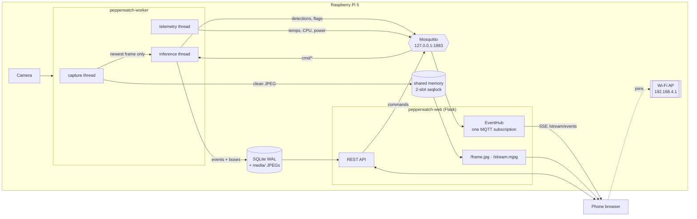
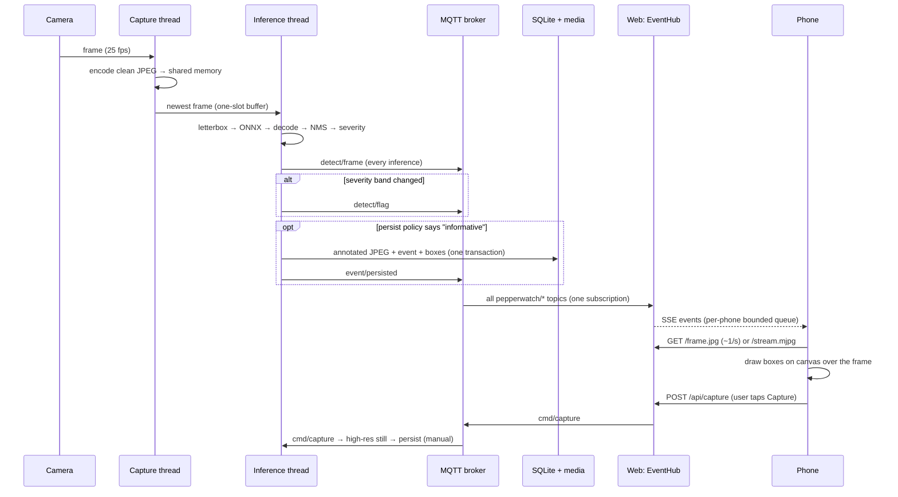
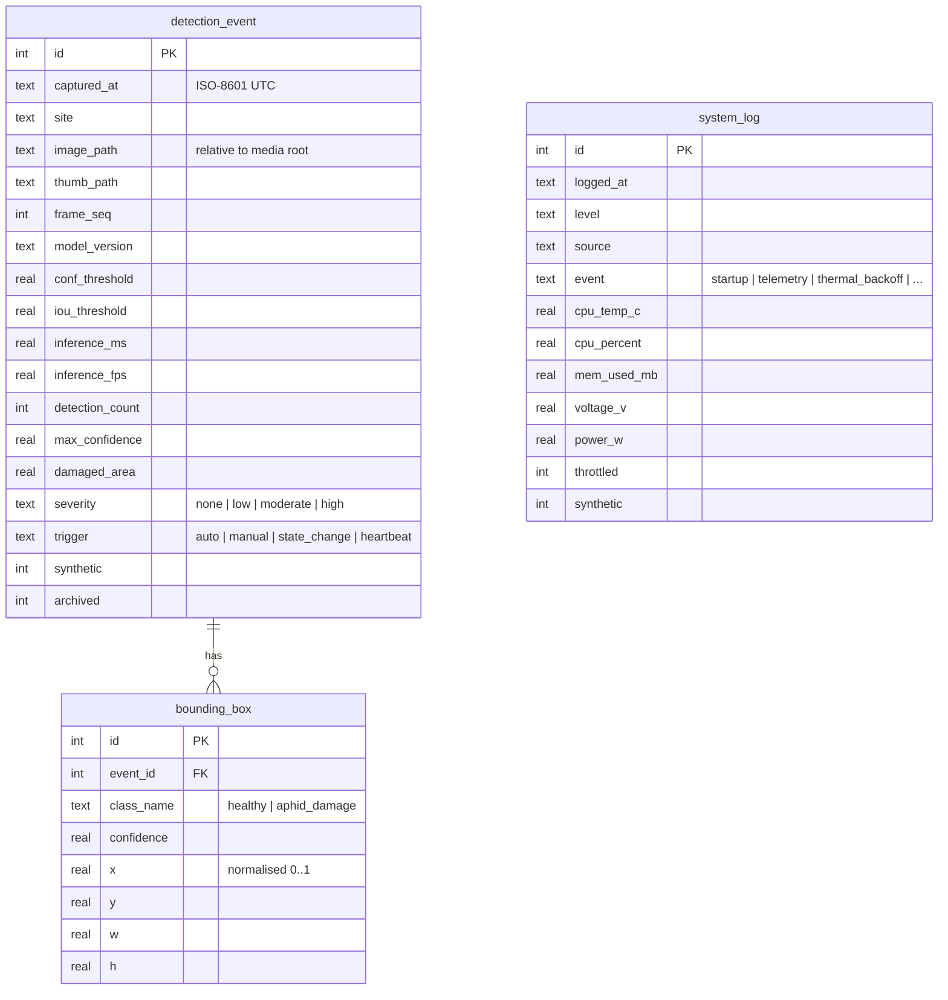
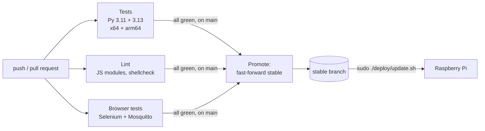

# Pepper Watch

[](https://github.com/TristanListanco/pepperwatch-aphid-detection/actions/workflows/ci.yml)

**Offline, on-device detection of aphid-induced leaf damage in bell pepper
(*Capsicum annuum*) for smallholder farms.**

A Raspberry Pi 5 watches the crop canopy through a camera and runs a YOLOv8n
model on every frame it can. It also broadcasts its own Wi-Fi network and serves
a live dashboard to any phone that joins. No internet, cloud account or app
install is needed: a farmer or agricultural officer joins the `PepperWatch`
network and the dashboard opens.

```
 camera ──► Raspberry Pi 5 ──────────────────────────────► phone browser
            detect → score severity → log → serve dashboard   (over the Pi's own Wi-Fi)
```

---

## Contents

- [Repository layout](#repository-layout)
- [System architecture](#system-architecture)
  - [Hardware and processes](#hardware-and-processes)
  - [From camera to phone: the detection pipeline](#from-camera-to-phone-the-detection-pipeline)
  - [Which data travels where](#which-data-travels-where)
  - [Data model](#data-model)
  - [Networking and the captive portal](#networking-and-the-captive-portal)
- [Quick start on a development machine](#quick-start-on-a-development-machine)
- [Deploying to a Raspberry Pi 5](#deploying-to-a-raspberry-pi-5)
- [Configuration](#configuration)
- [Adding the trained model](#adding-the-trained-model)
- [Using the dashboard](#using-the-dashboard)
- [REST API](#rest-api)
- [Operations](#operations)
- [Testing and benchmarking](#testing-and-benchmarking)
- [CI/CD: test before deploy](#cicd-test-before-deploy)
- [Troubleshooting](#troubleshooting)
- [Field dataset](#field-dataset)

---

## Repository layout

```
.
├── .github/workflows/ci.yml    Tests every push; promotes green commits to `stable`
├── datasets/                   Naawan field photographs, one folder per collector
│   ├── PHOEBIEN/  SHANICE/  TRISTAN/
└── websystem/                  The edge system: worker, dashboard, deployment
    ├── config/
    │   ├── default.toml        Every tunable, with comments
    │   ├── profiles/pi3.toml   Overrides for smaller boards
    │   └── recommendations.json  Advisory text (English + Cebuano)
    ├── pepperwatch/
    │   ├── worker.py           Capture + inference + persistence process
    │   ├── detect/             ONNX detector, letterbox/NMS/decoding, stub detector
    │   ├── hal/                Camera and sensor drivers: Pi (Picamera2/USB, INA219) and mock
    │   ├── frames.py           Shared-memory frame transport (worker → web)
    │   ├── mqtt_bus.py         MQTT topics and client wrapper
    │   ├── db.py, schema.sql   SQLite (WAL) access layer and schema
    │   ├── thermal.py          Thermal governor (backs off inference when hot)
    │   ├── advisory.py         Treatment-advice content loader
    │   ├── render.py           Draws boxes on saved images
    │   ├── doctor.py           Pre-flight diagnostics
    │   ├── maintenance.py      Nightly WAL truncation + log pruning
    │   └── web/                Flask app: REST, SSE, MJPEG, pages, captive portal
    ├── deploy/                 install.sh, update.sh, systemd units, Mosquitto, Wi-Fi AP
    ├── scripts/                dev.sh, prepare_mock_frames.py, bench_fps.py, check_js.sh
    ├── models/                 Drop pepperwatch.onnx here (not committed)
    └── tests/                  281 unit/API tests + 19 Selenium browser tests
```

`websystem/README.md` holds the engineering notes, including the list of
deliberate differences from the thesis manuscript.

---

## System architecture

### Hardware and processes

| Component | Role |
|---|---|
| Raspberry Pi 5 (8 or 16 GB) | Runs everything. Four Cortex-A76 cores, no accelerator; inference is CPU-only |
| Camera Module (MIPI CSI) or USB webcam | Image source, selected with `[camera].kind` |
| On-board Wi-Fi | Runs as an access point (`PepperWatch`, 2.4 GHz) that phones join |
| RTC coin cell (J5 connector) | Keeps the clock correct offline, since there is no NTP |
| INA219 (optional, I²C) | Voltage/current/power for the energy analysis |

Four long-running pieces of software run on the Pi, all managed by systemd
under one target, `pepperwatch.target`:

| Process | systemd unit | What it does |
|---|---|---|
| **Wi-Fi access point** | `pepperwatch-ap` | NetworkManager hotspot on `wlan0` at `192.168.4.1`, with DHCP and wildcard DNS for the captive portal |
| **MQTT broker** | `mosquitto` | Message bus, bound to `127.0.0.1` only |
| **Inference worker** | `pepperwatch-worker` | Owns the camera. Capture → infer → score → publish → persist |
| **Web server** | `pepperwatch-web` | Flask under gunicorn (1 process, 16 threads). Dashboard, REST API, live streams |

A nightly timer (`pepperwatch-maintenance.timer`, 02:00) truncates the SQLite
write-ahead log and prunes old telemetry rows.



### From camera to phone: the detection pipeline

This follows one frame from the lens to the farmer's screen. File references are
relative to `websystem/pepperwatch/`.

#### 1. Capture (`worker.py` → capture thread, `hal/`)

The capture thread reads the camera as fast as it delivers (target
`preview_fps = 25`). For each frame it:

1. JPEG-encodes the frame **without boxes** and publishes it into shared memory
   (`frames.py`) for the live view;
2. drops it into a **one-slot buffer** (`LatestFrame`).

The one-slot buffer is why the live view stays smooth when inference is slow. A
CPU-only YOLOv8n on a Pi 5 manages roughly 5–10 inferences per second at 640×640,
well below the camera rate. A queue would let the detector fall further and
further behind what the camera currently sees. With a single slot, a new frame
replaces any frame the detector hasn't taken yet, so inference always works on
the newest image. Dropped frames are counted and reported.

On a development Mac, `hal/mock.py` stands in for the camera by replaying the
Naawan field photographs.

#### 2. Inference (`worker.py` → inference thread, `detect/`)

The inference thread takes the newest frame and runs the pipeline:

| Step | Code | Detail |
|---|---|---|
| Letterbox | `detect/postprocess.py::letterbox` | Resize to a 640×640 square with padding, keeping the aspect ratio. The scale and padding are recorded so boxes can be mapped back exactly |
| Tensorise | `to_tensor` | BGR → RGB, HWC → NCHW, scale to 0–1 |
| Infer | `detect/onnx_detector.py` | ONNX Runtime on the CPU with 3 threads, leaving one core for the web server and OS. The Ultralytics/PyTorch stack isn't loaded |
| Decode | `decode_yolov8` | Reads the raw `(1, 4+classes, anchors)` head and applies the **confidence threshold** (default 0.25) |
| NMS | `non_max_suppression` | Per-class non-maximum suppression at `iou_threshold` (default 0.45) |
| Un-letterbox | `Letterbox.to_frame` | Maps boxes back to frame coordinates, then normalises them to 0–1 |

If no model file exists, `detect/stub_detector.py` takes over: a classical
computer-vision heuristic that finds pale speckling on green leaves. Everything
it produces is flagged **`synthetic`** in the database and on the dashboard, so it
can't be mistaken for model output.

#### 3. Severity scoring (`detect/postprocess.py::derive_severity`)

The model predicts two classes, `healthy` and `aphid_damage`. Severity is
derived in software from the `aphid_damage` boxes and takes **the worse of two
measures**:

| Band | Cluster count | *or* fraction of frame covered |
|---|---|---|
| none | 0 | 0 |
| low | ≤ 2 | ≤ 2 % |
| moderate | ≤ 5 | ≤ 8 % |
| high | > 5 | > 8 % |

The thresholds are in `[severity]` in `config/default.toml`.

#### 4. Publish (`mqtt_bus.py`)

Every inference result goes onto the MQTT bus. Images never do; only small JSON
messages travel over MQTT.

| Topic (`pepperwatch/…`) | QoS | When | Payload |
|---|---|---|---|
| `detect/frame` | 0 | every inference | boxes, severity, damaged area, inference ms |
| `detect/flag` | 1 | when severity changes | new/previous severity, count, max confidence |
| `event/persisted` | 1 | when a row is saved | event id, image/thumbnail paths |
| `telemetry/system` | 0 | ~1 s | CPU temp, CPU %, memory, disk, power, throttling, thermal level |
| `telemetry/pipeline` | 0 | ~1 s | preview fps, inference fps, inference ms, dropped frames, paused |
| `status/worker` | 1, retained, Last Will | on connect / disconnect / crash | `online` / `offline` |
| `status/detector` | 1, retained | on start | model version, detector kind, synthetic flag |
| `cmd/capture`, `cmd/inference`, `cmd/config` | 1 | from the dashboard | snapshot, pause/resume, threshold changes |

The retained status topics mean a dashboard that connects late immediately
learns whether the detector is alive and which model it runs. The Last Will
marks the worker offline within the keepalive window if it crashes.

#### 5. Persist (`worker.py::PersistPolicy`, `db.py`)

At 17 fps over an 8-hour day the camera produces about 490,000 frames, so
writing every frame would wear out the SD card and make the history unreadable.
A frame becomes a database row only when it is informative:

| Trigger | Rule |
|---|---|
| `state_change` | Severity moved to a new band **and held it for 4 s** (debounce, so a count hovering on a boundary doesn't write every frame) |
| `heartbeat` | 30 s since the last write while damage is visible; 300 s while clean |
| `manual` | The user pressed *Capture*. A full-resolution still is taken, and this trigger is exempt from the rate cap |
| — | Hard cap: automatic writes are at most one per 8 s whatever the trigger |

Each saved event stores:
- an **annotated** JPEG and a 320 px thumbnail under `media/YYYY/MM/DD/`. Saved
  images have the boxes drawn in, so they make sense on their own as evidence;
- one `detection_event` row plus one `bounding_box` row per box, written in a
  single transaction;
- provenance: model version, both thresholds, inference time and fps, so every
  result can be traced to the exact settings that produced it.

#### 6. Bridge to the browser (`web/hub.py`, `web/routes_stream.py`)

Browsers can't speak MQTT. The web process holds **one** MQTT subscription
(`EventHub`) and fans each message out to every connected phone as
**Server-Sent Events** on `/stream/events`. Each phone gets a small bounded
queue: a phone on a weak link loses old messages instead of slowing down the
worker. This is also why gunicorn must run exactly one process: two processes
would mean two hubs, and each phone would see only half the traffic.

The live picture is served separately, straight from shared memory:

- `/frame.jpg` returns the latest frame. **This is the default:** the page polls
  it about once a second, roughly 0.4 Mbit/s per phone.
- `/stream.mjpg` is a continuous MJPEG stream, opened only when the user taps
  *Start Camera*. It's throttled to `stream_fps = 10` and limited to 4 viewers,
  because the Pi's radio in AP mode can only carry a few such streams.

Shared memory uses two slots behind a seqlock: the writer fills the idle slot
and then flips the header, and readers retry if it changed while they copied. No
lock is involved, so a slow reader can never block the inference loop.

#### 7. The dashboard (`web/static/js/`)

The page is plain ES modules with no build step and no CDN; everything is served
from the Pi.

- **`bus.js`** opens the SSE connection. If it drops (a phone walking out of
  range), it falls back to polling `/api/telemetry`, `/api/pipeline` and
  `/api/detections/latest` every 2 s and reconnects when it can.
- **`liveview.js`** shows the clean frame and draws the latest boxes on a
  `<canvas>` overlay, scaled to the phone's screen. Boxes are stored normalised
  (0–1), so they line up at any resolution.
- Panels update from the same event stream: KPI tiles, distribution donut,
  history gallery, system health, and the advisory panel, which picks text from
  `recommendations.json` by severity and language (English or Cebuano).

#### 8. Commands back to the worker

User actions travel the other way:

```
button → REST (POST /api/capture, /api/inference/pause, PATCH /api/config)
       → [control PIN check] → MQTT pepperwatch/cmd/* → worker
```

The API answers `202 Accepted` right away. The worker acts asynchronously: a
snapshot appears in the gallery when the matching `event/persisted` message
arrives.

#### End-to-end sequence



#### Keeping it running in the field

- **Thermal governor (`thermal.py`).** Above 75 °C the worker stretches the gap
  between inferences: 2× at 75 °C, 4× at 78 °C, 8× at 81 °C, recovering with a
  4 °C margin so it doesn't flip back and forth. The live preview keeps its full
  rate. Every level change is logged and shown in the System Health panel, so a
  drop in fps has a visible cause.
- **Degrade, don't crash.** If the broker is down, the worker keeps detecting
  and the dashboard keeps serving history.
- **SQLite in WAL mode.** One connection per thread, `BEGIN IMMEDIATE` for writes
  and short transactions, so the dashboard can read history while the worker
  writes.
- **systemd** restarts each service on failure and caps its memory (2 GB worker,
  1 GB web).

### Which data travels where

| Data | Channel | Why |
|---|---|---|
| Live frames | Shared memory → HTTP (`/frame.jpg`, MJPEG) | Images are too large for MQTT; shared memory has no copy through the broker and no locks |
| Detections, telemetry, status | MQTT → SSE | Small, frequent and fan-out; worker and web can restart independently |
| History, images, stats, export | SQLite/media → REST | Large or queried on demand |
| User commands | REST → MQTT `cmd/*` | The PIN is checked at the REST edge; the worker never faces the network |

### Data model

`pepperwatch/schema.sql` defines three tables:



Detection events are never pruned automatically; they're the research record.
`system_log` rows older than `retention_days` (90) are pruned nightly.

### Networking and the captive portal

- `deploy/network/setup-ap.sh` creates a NetworkManager hotspot: SSID
  `PepperWatch`, WPA2, 2.4 GHz channel 6, address `192.168.4.1/24`, DHCP range
  `.50–.150`. 2.4 GHz is chosen for range in an open field.
- `dnsmasq-shared.d/00-pepperwatch-captive.conf` resolves **every** hostname to
  the Pi and advertises the dashboard via DHCP option 114 (RFC 8910).
- `web/routes_portal.py` answers the connectivity checks of Android, iOS/macOS
  and Windows (`/generate_204`, `/hotspot-detect.html`, `/ncsi.txt`, …), so
  phones show the "sign in to network" prompt that opens the dashboard.
- Any unknown page redirects to the dashboard; unknown `/api/` paths still
  return 404.

---

## Quick start on a development machine

Everything runs on a Mac without a Pi or camera. The mock camera replays the
field photographs and the mock telemetry models a day's temperatures.

**Prerequisites:** Python 3.11+, [Homebrew](https://brew.sh), Git, and Chrome
(only for the Selenium tests).

```bash
git clone https://github.com/TristanListanco/pepperwatch-aphid-detection.git
cd pepperwatch-aphid-detection/websystem

python3.11 -m venv .venv
.venv/bin/pip install -r requirements-dev.txt
brew install mosquitto

./scripts/dev.sh            # builds the mock frames, starts broker + worker + web
```

Open <http://localhost:8000> and tap **Start Camera**. Then:

```bash
./scripts/dev.sh status     # what's running
./scripts/dev.sh stop       # stop everything
tail -f var/worker.log var/web.log
.venv/bin/python -m pepperwatch.doctor   # check the setup
```

> The first `dev.sh` run builds `var/mock_frames/` from about 300 photos at the
> `datasets-v1` tag. A full clone already has them. To build from a folder of
> images instead, run
> `.venv/bin/python scripts/prepare_mock_frames.py --source /path/to/photos`.

You can also run the processes by hand: start `mosquitto`, then
`python -m pepperwatch.worker` and `python -m pepperwatch.web` in separate
terminals.

---

## Deploying to a Raspberry Pi 5

### What you need

- Raspberry Pi 5 (8 or 16 GB), official 27 W power supply, active cooler
- Camera Module on the CSI port, or a USB webcam (set `[camera].kind = "usb"`)
- 64 GB+ microSD card, or a USB SSD for long field runs (more write endurance)
- RTC coin cell on the J5 connector
- Optional: INA219 power monitor on I²C

### 1. Prepare the OS

Flash **Raspberry Pi OS (64-bit)** with Raspberry Pi Imager. Lite is the
deployment image; the desktop image works too (see step 4). 64-bit is required:
ONNX Runtime has no 32-bit ARM builds, and the installer refuses to run on one.

```bash
sudo apt update && sudo apt full-upgrade -y
sudo raspi-config        # Interface Options → SSH on; I2C on if you have an INA219
sudo reboot
```

Connect the camera with the Pi **powered off**. Use **Ethernet** during setup:
once the access point starts it takes over `wlan0`, which drops any Wi-Fi or SSH
session running over Wi-Fi.

### 2. Get the code

Clone the **`stable`** branch, which only ever holds commits that passed CI
(see [CI/CD](#cicd-test-before-deploy)). You don't need the 4 GB of photos on
the Pi, so check out just the web system:

```bash
git clone --branch stable --filter=blob:none --sparse \
  https://github.com/TristanListanco/pepperwatch-aphid-detection.git
cd pepperwatch-aphid-detection
git sparse-checkout set websystem
cd websystem
```

If you have a trained model, put it at `models/pepperwatch.onnx` now (see
[Adding the trained model](#adding-the-trained-model)).

### 3. Install

```bash
sudo ./deploy/install.sh
```

The installer:

1. detects the board and RAM and refuses to run on a 32-bit userland;
2. installs apt packages (Picamera2, libcamera, Mosquitto, NetworkManager, …);
3. sets up the clock (hardware RTC or `fake-hwclock`);
4. creates the `pepperwatch` system user (groups `video`, `i2c`, `gpio`);
5. copies the app to `/opt/pepperwatch` and builds a virtualenv with
   `--system-site-packages` (Picamera2 only comes from apt);
6. writes `/opt/pepperwatch/config/local.toml` with a random Flask secret;
7. **generates the Wi-Fi password** in `/etc/pepperwatch/ap.psk` and prints it;
   write it down;
8. installs the systemd units (plus board-specific overrides for smaller Pis) and
   enables `pepperwatch.target` and the maintenance timer;
9. runs `pepperwatch.doctor --camera-probe`.

It's safe to run more than once. Re-running upgrades the install and keeps the
database, images, `local.toml` and Wi-Fi password.

### 4. Headless for measurements (desktop image only)

The desktop session uses CPU and adds heat that shows up in the frame rate. Boot
to the console before any benchmark or field trial:

```bash
sudo systemctl set-default multi-user.target     # back: graphical.target
```

If you joined a Wi-Fi network from the desktop, stop it from fighting the access
point:

```bash
nmcli connection modify "<network name>" connection.autoconnect no
```

### 5. Start and connect

```bash
sudo systemctl start pepperwatch.target      # or just reboot
journalctl -fu pepperwatch-worker -u pepperwatch-web
```

On a phone, join **PepperWatch** with the password from
`/etc/pepperwatch/ap.psk`. The dashboard opens by itself; if it doesn't, browse
to **<http://192.168.4.1:8000/>**.

### 6. Before a field trial

- [ ] `doctor` passes:
      `sudo -u pepperwatch /opt/pepperwatch/.venv/bin/python -m pepperwatch.doctor`
- [ ] The RTC battery is fitted (the clock is right after a power cut)
- [ ] `models/pepperwatch.onnx` is installed. With the stub detector, results are
      flagged synthetic and are **not** data
- [ ] A control PIN is set (see [Configuration](#configuration))
- [ ] `config/recommendations.json` has been signed off by an agriculturist. Until
      then the dashboard shows a draft banner
- [ ] Booted to the console, not the desktop

### Updating

With Ethernet plugged in:

```bash
cd ~/pepperwatch-aphid-detection/websystem
sudo ./deploy/update.sh
```

`update.sh` fast-forwards to the newest commit on `stable`, lists what changed,
re-runs `install.sh`, and restarts the worker and web server if they were
running. It refuses to run over local edits to tracked files. To try an untested
commit on a bench Pi, run `sudo PW_DEPLOY_BRANCH=main ./deploy/update.sh`.

---

## Configuration

### How settings are layered

Later layers win:

```
config/default.toml  →  config/profiles/<board>.toml  →  config/local.toml  →  PW_* environment
```

- **`default.toml`** has every setting with comments, sized for a Pi 5. Don't
  edit it for one machine.
- **`profiles/<board>.toml`** is applied automatically from
  `/proc/device-tree/model` (only `pi3` ships). Force one with `PW_BOARD=pi3`.
- **`local.toml`** holds your machine's overrides and secrets. It's gitignored;
  on the Pi it's `/opt/pepperwatch/config/local.toml`.
- **Environment variables** are `PW_` plus the table and key in capitals:
  `[inference].conf_threshold` → `PW_INFERENCE_CONF_THRESHOLD`.

Values are converted to the type of the default they replace, so a typo fails at
startup, not halfway through a trial.

Example `local.toml`:

```toml
[site]
name = "Naawan"

[camera]
kind = "csi"            # or "usb"
rotate = 180            # if the camera is mounted upside down

[inference]
conf_threshold = 0.35

[web]
control_pin = "4821"    # required for capture/pause/settings changes
secret_key = "…generated by install.sh…"

[db]
path = "/var/lib/pepperwatch/db/pepperwatch.db"

[media]
root = "/var/lib/pepperwatch/media"
```

After editing, restart: `sudo systemctl restart pepperwatch-worker pepperwatch-web`.

### Settings you're most likely to change

| Key | Default | Notes |
|---|---|---|
| `site.name` | `Naawan` | Saved with every event |
| `camera.kind` | `csi` | `csi` (Picamera2) or `usb` (OpenCV, `device_index`) |
| `camera.preview_width/height/fps` | 640×480 @ 25 | Live preview capture |
| `camera.still_width/height` | 2304×1296 | Manual snapshot resolution |
| `camera.rotate` | 0 | 0, 90, 180 or 270 |
| `inference.model_path` | `models/pepperwatch.onnx` | Missing file → stub detector |
| `inference.input_size` | 640 | A static-shape model's own size takes priority |
| `inference.conf_threshold` | 0.25 | Also live-adjustable on the Settings page |
| `inference.iou_threshold` | 0.45 | NMS overlap; also live-adjustable |
| `inference.intra_op_threads` | 3 | ONNX threads; leave one core free |
| `inference.class_names` | `["healthy", "aphid_damage"]` | Must match the model's class order |
| `severity.*` | see above | Band thresholds by count and area |
| `persist.heartbeat_detected_s` / `heartbeat_clean_s` | 30 / 300 | Periodic saves |
| `persist.min_write_interval_s` | 8 | Hard cap on automatic saves |
| `persist.retention_days` | 90 | `system_log` pruning (events are kept) |
| `web.port` | 8000 | |
| `web.stream_fps` / `max_stream_clients` | 10 / 4 | MJPEG limits |
| `web.control_pin` | empty | Empty = anyone on the Wi-Fi can pause or reconfigure |

### Wi-Fi access point

| Setting | Where | Default |
|---|---|---|
| Password | `/etc/pepperwatch/ap.psk` (root-only, ≥ 8 chars) | random, generated at install |
| SSID, band, channel, address | env vars on `setup-ap.sh`: `PW_AP_SSID`, `PW_AP_BAND`, `PW_AP_CHANNEL`, `PW_AP_ADDRESS`, `PW_AP_IFACE` | `PepperWatch`, `bg`, `6`, `192.168.4.1/24`, `wlan0` |

To change the password, edit `ap.psk` and run
`sudo systemctl restart pepperwatch-ap`. If you change the address, also update
`deploy/network/dnsmasq-shared.d/00-pepperwatch-captive.conf` and
`[portal].address`.

### Advisory content

`config/recommendations.json` holds the advice shown for each class and
severity, in English (`en`) and Cebuano (`ceb`). It deliberately names no
pesticides or doses, and it escalates to the local DA/ATI technician. Set
`meta.status` to `validated` and fill in `meta.sign_off` once an agriculturist
has reviewed it; the draft banner then goes away.

---

## Adding the trained model

The worker expects a **YOLOv8 ONNX export** with two classes in this order:
`0 = healthy`, `1 = aphid_damage`.

```bash
# on the training machine (Ultralytics installed)
yolo export model=best.pt format=onnx imgsz=640
```

Copy the result to `websystem/models/pepperwatch.onnx` **in your checkout**,
then run `sudo ./deploy/install.sh`. Don't copy it straight into
`/opt/pepperwatch/models/`: the installer mirrors the checkout into
`/opt/pepperwatch`, so the next install would delete it. `*.onnx` is
gitignored, so the model won't end up in the repository by accident.

On start, the worker logs the model file and input size and publishes them on
`status/detector`; the dashboard's health panel shows which model is running.
If the class order differs, change `inference.class_names` to match.

---

## Using the dashboard

| Page | Contents |
|---|---|
| `/` Dashboard | **Live Inference View** (frame + box overlay, Start Camera for MJPEG), **KPI tiles** (weekly detections, average confidence, trend, severity), **distribution donut**, **Historical Detection Log** (searchable gallery of saved scans), **System Health Monitor** (temperature, CPU, memory, power, thermal back-off), **Actionable Output Panel** (advice in English/Cebuano), **Capture & Export** (snapshot, pause/resume, CSV) |
| `/archived` | Scans hidden from the main gallery |
| `/settings` | Confidence/IoU sliders, language, control PIN |

If a control PIN is set, the Capture, Pause/Resume, Archive and Settings
changes ask for it.

---

## REST API

All responses are JSON unless noted. 🔒 = needs the control PIN (header
`X-Pepper-Pin` or `"pin"` in the JSON body) when one is configured.

| Method | Path | Purpose |
|---|---|---|
| GET | `/api/health` | Liveness, worker status, detector/model, DB stats, server time |
| GET | `/api/telemetry` | Latest hardware readings (live, or last stored) |
| GET | `/api/pipeline` | Preview/inference fps, latency, dropped frames |
| GET | `/api/detections/latest` | Newest boxes for the overlay |
| GET | `/api/events` | Saved scans. Query: `from`, `to`, `severity`, `class`, `q`, `archived`, `limit`, `offset` |
| GET | `/api/events/<id>` | One scan with its boxes |
| POST 🔒 | `/api/events/<id>/archive` | Archive / unarchive |
| GET | `/api/stats/weekly` | KPI aggregates |
| GET | `/api/recommendations[/<severity>]` | Advisory text (`?locale=en\|ceb`) |
| GET | `/api/export.csv` | One row per box, with provenance columns. Query: `from`, `to` |
| POST 🔒 | `/api/capture` | Request a high-res snapshot → `202` |
| POST 🔒 | `/api/inference/pause` · `/resume` | Pause or resume detection → `202` |
| GET / PATCH 🔒 | `/api/config` | Read / live-change `conf_threshold`, `iou_threshold` (0.01–0.99) |
| POST 🔒 | `/api/time` | Record a client's clock if the Pi's is behind (logged; not applied) |
| POST 🔒 | `/api/detections` | Ingest a detection payload over HTTP (used by the tests) |
| GET | `/frame.jpg` | Latest frame (clean) |
| GET | `/stream.mjpg` | MJPEG live stream |
| GET | `/stream/events` | Server-Sent Events (MQTT bridge) |
| GET | `/stream/status` | Viewer counts and limits |
| GET | `/media/<path>` | Saved annotated images and thumbnails |

```bash
curl http://192.168.4.1:8000/api/health
curl -X POST -H 'X-Pepper-Pin: 4821' http://192.168.4.1:8000/api/capture
curl -o scans.csv 'http://192.168.4.1:8000/api/export.csv'
```

---

## Operations

### Service commands

```bash
sudo systemctl start|stop|restart pepperwatch.target    # everything
sudo systemctl restart pepperwatch-worker               # just inference
systemctl status pepperwatch-worker pepperwatch-web pepperwatch-ap mosquitto
journalctl -u pepperwatch-worker -n 100 --no-pager
```

### Where things live on the Pi

| Path | Contents |
|---|---|
| `/opt/pepperwatch/` | Installed app and virtualenv |
| `/opt/pepperwatch/config/local.toml` | Site config and secrets |
| `/etc/pepperwatch/ap.psk` | Wi-Fi password |
| `/var/lib/pepperwatch/db/pepperwatch.db` | SQLite database (+ `-wal`, `-shm`) |
| `/var/lib/pepperwatch/media/YYYY/MM/DD/` | Annotated scans and thumbnails |
| `/dev/shm/pepperwatch_frames` | Live frame buffer (RAM only) |

### Backing up results

```bash
# consistent copy of the database while it's running (sudo apt install sqlite3 first)
sudo sqlite3 /var/lib/pepperwatch/db/pepperwatch.db ".backup /tmp/pepperwatch-$(date +%F).db"
# images
rsync -a /var/lib/pepperwatch/media/ /path/to/usb/media/
```

Or download `/api/export.csv` from a phone on the network.

### Health check

```bash
sudo -u pepperwatch /opt/pepperwatch/.venv/bin/python -m pepperwatch.doctor [--camera-probe]
```

`doctor` checks the Python version, virtualenv, numpy/libcamera ABI match,
imports, clock and RTC, board profile, whether memory limits fit the RAM, camera,
broker, database, model, free storage, temperature, and advisory sign-off.

---

## Testing and benchmarking

From `websystem/` on the development machine:

```bash
.venv/bin/python -m pytest               # 281 unit/API tests (~1 min)
.venv/bin/python -m pytest -m selenium   # 19 browser tests (needs Chrome, ~4 min)
./scripts/check_js.sh                    # ES-module syntax check (no build step)
```

The tests cover letterbox round-trips, YOLOv8 decoding, NMS, severity, the
persist policy, the shared-memory seqlock, SQLite concurrency (8 readers vs a
live writer), the REST/SSE/MJPEG endpoints, the captive portal, the deploy files
and board profiles. The Selenium suite checks the dashboard keeps updating, stays
responsive and doesn't leak memory.

**Frame-rate benchmark**, run on the Pi booted to the console:

```bash
sudo systemctl stop pepperwatch-worker        # free the camera
cd /opt/pepperwatch
sudo -u pepperwatch .venv/bin/python scripts/bench_fps.py \
  --sizes 320,416,640 --threads 2,3,4 --seconds 30
```

It times each stage separately (preprocess, infer, decode, severity, encode)
and writes a CSV to `benchmarks/`. It reports three different fps figures:
`capture_fps` (the camera), `inference_fps` (the model alone) and
`pipeline_fps` (the whole loop). Quote the one that matches the claim you're
making.

---

## CI/CD: test before deploy

Every push and pull request runs `.github/workflows/ci.yml` on GitHub Actions.
The Pi never deploys `main` directly. It deploys `stable`, a branch that CI
moves forward **only after every job has passed** on that exact commit.



| Job | What it checks |
|---|---|
| **Tests** | The 281 unit/API tests on Python 3.11 (Raspberry Pi OS Bookworm) and 3.13 (Trixie), on x64 and on **arm64**, the Pi 5's architecture, so a missing aarch64 wheel fails in CI rather than on the device |
| **Lint** | Every dashboard script parses as an ES module (`check_js.sh`); `shellcheck` on the deploy and helper scripts |
| **Browser tests** | The 19 Selenium tests against a real worker, web server and Mosquitto broker, with mock frames built from a couple of dozen `datasets-v1` photos (cached between runs). The job **fails if any test is skipped**, so a run that silently tested nothing can't promote a commit |
| **Promote** | Runs only for pushes to `main` once the three jobs above pass. It fast-forwards `stable` to the tested commit; a fast-forward-only update means a late-finishing older run can never move `stable` backwards |

CI checks out only `websystem/` (a sparse, blob-less checkout), so the 4 GB
dataset is never downloaded.

**Pull requests** run the same jobs but never promote. To make the checks
mandatory before merging, enable branch protection on `main` (Settings →
Branches → require status checks: the *Tests*, *Lint* and *Browser tests* jobs).

The Pi can't be deployed to from GitHub: in the field it has no internet and
isn't reachable from outside. Deployment therefore stays a pull. When the Pi
has Ethernet, `update.sh` fetches whatever CI last approved.

---

## Troubleshooting

| Symptom | Likely cause / fix |
|---|---|
| Installer stops: `Unable to locate package libatlas-base-dev` | Newer Raspberry Pi OS releases may have dropped it. Remove it from the `apt-get install` list in `deploy/install.sh` and re-run; the app doesn't need it |
| Installer: "not aarch64" | 32-bit OS. Reflash with Raspberry Pi OS (64-bit) |
| Dashboard says **synthetic** | No `models/pepperwatch.onnx`, so the stub detector is running. Add the model |
| Worker exits "no frame arrived from the camera" | Check the ribbon cable or USB, `rpicam-hello --list-cameras`, and `camera.kind` |
| `doctor` warns about numpy ABI | A pip-installed numpy is shadowing apt's. `sudo -u pepperwatch /opt/pepperwatch/.venv/bin/pip uninstall numpy` |
| Phone joins but no page opens | Browse to `http://192.168.4.1:8000/`. Some phones ignore captive portals while mobile data is on |
| `PepperWatch` network not visible | `systemctl status pepperwatch-ap`; check `/etc/pepperwatch/ap.psk` exists (≥ 8 chars); another saved Wi-Fi network may be holding `wlan0` |
| Lost SSH when the system started | The AP took over `wlan0`. Use Ethernet, or join `PepperWatch` and SSH to `192.168.4.1` |
| fps drops after a while | Check the System Health panel for thermal back-off. Improve cooling or ventilation |
| Timestamps wrong after a power cut | No RTC battery. Fit one on J5 |
| Live view frozen but data updates | MJPEG viewer limit reached (4). Close other tabs, or stay in the default poll mode |
| Dashboard shows the worker offline | `journalctl -u pepperwatch-worker`; check `systemctl status mosquitto` |

---

## Field dataset

`datasets/` contains 1,143 photographs of bell pepper leaves collected in Naawan,
Misamis Oriental, in one folder per collector (`PHOEBIEN/`, `SHANICE/`,
`TRISTAN/`). They're used to build the development mock camera and as the source
for training data.

- The set is tagged **`datasets-v1`**. Its history is split over four commits
  so each push stays under GitHub's 2 GB limit; the tag points at the commit that
  contains all of it.
- To get the code without the photos, use the sparse clone from
  [Deploying](#2-get-the-code).
