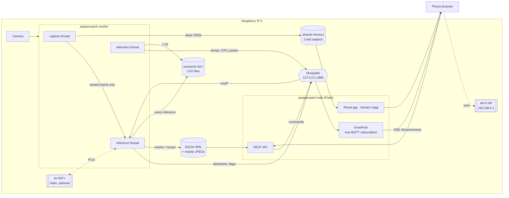
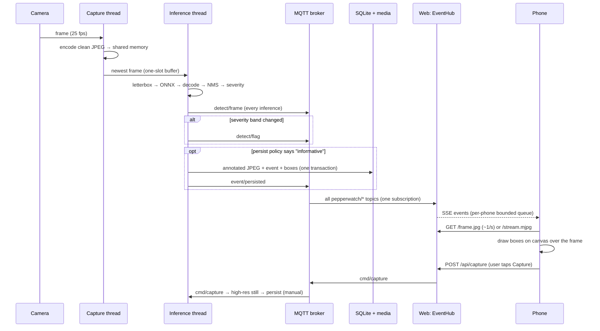
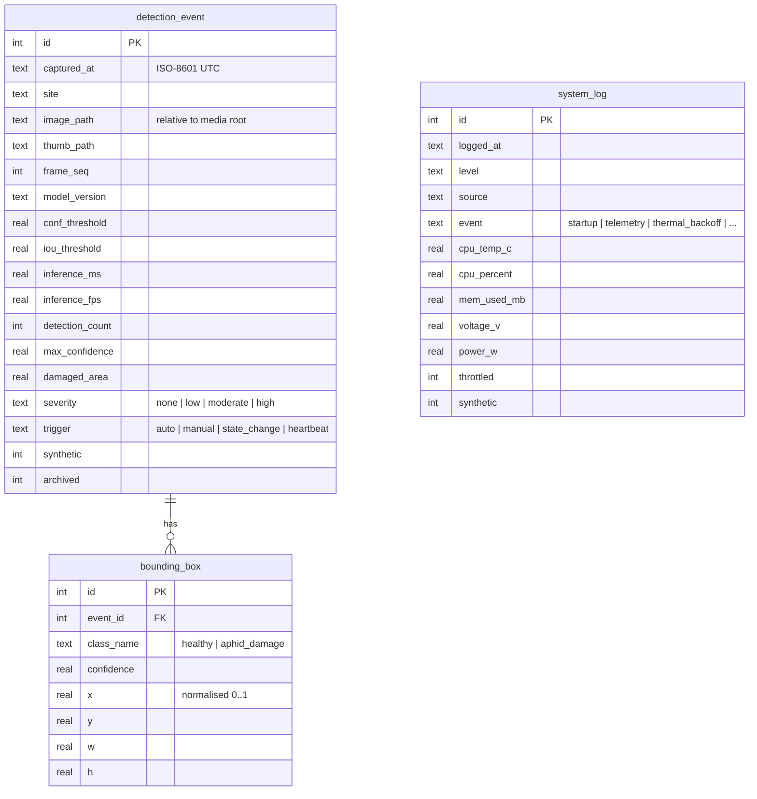
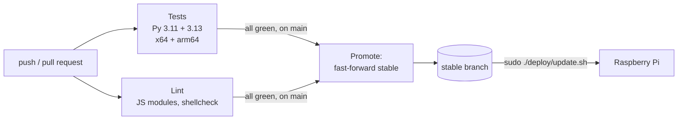

# Pepper Watch

[](https://github.com/TristanListanco/pepperwatch-aphid-detection/actions/workflows/ci.yml)

**Offline, on-device detection of aphid-induced leaf damage in bell pepper
(*Capsicum annuum*) for smallholder farms.**

A Raspberry Pi 5 watches the crop canopy through a camera and runs a YOLOv8n
model on every frame it can, on its CPU or on a Raspberry Pi AI HAT+ when one
is fitted. It also runs on older Raspberry Pis and on other 64-bit ARM boards
such as the Orange Pi and Banana Pi, tuning itself to each board's CPU and
RAM. It also broadcasts its own Wi-Fi network and serves a live dashboard
to any phone that joins. No internet, cloud account or app install is needed: a
farmer or agricultural officer joins the `PepperWatch` network and the dashboard
opens.

Every run is recorded as a **session**: per-inference timings, frame rates,
power and temperatures go to CSV files for the results chapter.

```
 camera ──► Raspberry Pi 5 (+ AI HAT+) ──────────────────────► phone browser
            detect → score severity → log → record CSV → serve dashboard
```

This system runs on the Raspberry Pi only. The test suite runs anywhere with
Python 3.11+, since it needs no hardware.

---

## Contents

- [Repository layout](#repository-layout)
- [System architecture](#system-architecture)
  - [Hardware and processes](#hardware-and-processes)
  - [From camera to phone: the detection pipeline](#from-camera-to-phone-the-detection-pipeline)
  - [Which data travels where](#which-data-travels-where)
  - [Data model](#data-model)
  - [Networking and the captive portal](#networking-and-the-captive-portal)
- [Supported boards](#supported-boards)
- [Deploying to a Raspberry Pi 5](#deploying-to-a-raspberry-pi-5)
- [AI HAT+ acceleration](#ai-hat-acceleration)
- [Measurements: session CSV files](#measurements-session-csv-files)
- [Configuration](#configuration)
- [Adding the trained model](#adding-the-trained-model)
- [Using the dashboard](#using-the-dashboard)
- [REST API](#rest-api)
- [Security](#security)
- [Operations](#operations)
- [Testing and benchmarking](#testing-and-benchmarking)
- [CI/CD: test before deploy](#cicd-test-before-deploy)
- [Troubleshooting](#troubleshooting)
- [Field dataset](#field-dataset)

---

## Repository layout

```
.
├── .github/workflows/ci.yml    Tests every push; promotes green commits to `stable`
├── datasets/                   Naawan field photographs, one folder per collector
│   ├── PHOEBIEN/  SHANICE/  TRISTAN/
└── websystem/                  The edge system: worker, dashboard, deployment
    ├── config/
    │   ├── default.toml        Every tunable, with comments
    │   ├── profiles/           mid.toml, low.toml, tiny.toml: settings for slower boards
    │   └── recommendations.json  Advisory text (English + Cebuano)
    ├── pepperwatch/
    │   ├── worker.py           Capture + inference + persistence process
    │   ├── board.py            Board detection: family, CPU class, RAM -> tier
    │   ├── accel.py            AI HAT+ detection; CPU-or-Hailo choice per session
    │   ├── session.py          Per-session CSV recorder (inference, system, summary)
    │   ├── detect/             Hailo and ONNX detectors, letterbox/NMS/decoding, stub
    │   ├── hal/                Camera discovery (CSI/USB), drivers, PMIC/INA219 power
    │   ├── frames.py           Shared-memory frame transport (worker → web)
    │   ├── mqtt_bus.py         MQTT topics and client wrapper
    │   ├── db.py, schema.sql   SQLite (WAL) access layer and schema
    │   ├── thermal.py          Thermal governor (backs off inference when hot)
    │   ├── advisory.py         Treatment-advice content loader
    │   ├── render.py           Draws boxes on saved images
    │   ├── doctor.py           Pre-flight diagnostics
    │   ├── maintenance.py      Nightly WAL truncation + log pruning
    │   └── web/                Flask app: REST, SSE, MJPEG, pages, captive portal
    ├── deploy/                 install.sh, update.sh, systemd units, Mosquitto, Wi-Fi AP
    ├── scripts/                bench_fps.py (CPU vs AI HAT+), check_js.sh
    ├── models/                 pepperwatch.onnx and pepperwatch_<chip>.hef (not committed)
    └── tests/                  344 hardware-free unit and API tests
```

`websystem/README.md` holds the engineering notes, including the list of
deliberate differences from the thesis manuscript.

---

## System architecture

### Hardware and processes

| Component | Role |
|---|---|
| Raspberry Pi 5 (8 or 16 GB) | Runs everything. Inference runs on its four Cortex-A76 cores unless an AI HAT+ is fitted. Older Pis and other 64-bit ARM boards work too: see [Supported boards](#supported-boards) |
| Raspberry Pi AI HAT+ (optional) | Hailo-8L (13 TOPS), Hailo-8 (26 TOPS) or Hailo-10H (AI HAT+ 2) on PCIe. Detected at the start of each session and used automatically |
| Camera Module (MIPI CSI) or USB webcam | Image source. Detected at the start of each session; CSI preferred when both are attached |
| On-board Wi-Fi | Runs as an access point (`PepperWatch`, 2.4 GHz) that phones join |
| RTC coin cell (J5 connector) | Keeps the clock correct offline, since there is no NTP |
| Pi 5 PMIC (built in) | Per-rail voltage and current, so every session has a power figure with no extra hardware |
| INA219 (optional, I²C) | Whole-device voltage, current and power, which the PMIC cannot see |

Four long-running pieces of software run on the Pi, all managed by systemd
under one target, `pepperwatch.target`:

| Process | systemd unit | What it does |
|---|---|---|
| **Wi-Fi access point** | `pepperwatch-ap` | NetworkManager hotspot on `wlan0` at `192.168.4.1`, with DHCP and wildcard DNS for the captive portal |
| **MQTT broker** | `mosquitto` | Message bus, bound to `127.0.0.1` only |
| **Inference worker** | `pepperwatch-worker` | Owns the camera. Capture → infer → score → publish → persist |
| **Web server** | `pepperwatch-web` | Flask under gunicorn (1 process, 16 threads). Dashboard, REST API, live streams |

A nightly timer (`pepperwatch-maintenance.timer`, 02:00) truncates the SQLite
write-ahead log and prunes old telemetry rows.



### From camera to phone: the detection pipeline

This follows one frame from the lens to the farmer's screen. File references are
relative to `websystem/pepperwatch/`.

#### 0. Session start: what hardware is attached (`accel.py`, `hal/discovery.py`)

Each time the worker starts (at boot, or when *New session* is pressed on the
dashboard), it checks the hardware before any frame is taken:

1. **Accelerator.** It looks for Hailo's PCI vendor ID (`0x1e60`) in sysfs. If an
   AI HAT+ is there, its driver is loaded (`/dev/hailo0`), HailoRT imports, and
   a compiled model matching the chip is in `models/`, the session runs on the
   HAT. Otherwise it runs on the CPU, and the reason is recorded.
2. **Profile.** The matching `[profiles.hailo]` or `[profiles.cpu]` table is
   applied: the HAT profile captures at up to 60 fps because inference keeps
   up; the CPU profile captures at 25 fps and gives ONNX Runtime 3 threads.
3. **Camera.** CSI cameras are listed through libcamera and USB webcams through
   sysfs (`uvcvideo` driver). The CSI camera is used if present, otherwise the
   webcam; if the preferred one won't start, the next is tried.
4. **Recording.** A session folder is created and every inference and a
   once-a-second system sample are written to CSV (see
   [Measurements](#measurements-session-csv-files)).

#### 1. Capture (`worker.py` → capture thread, `hal/`)

The capture thread reads the camera as fast as it delivers (target
`preview_fps = 25`). For each frame it:

1. JPEG-encodes the frame **without boxes** and publishes it into shared memory
   (`frames.py`) for the live view;
2. drops it into a **one-slot buffer** (`LatestFrame`).

The one-slot buffer is why the live view stays smooth when inference is slow. A
CPU-only YOLOv8n on a Pi 5 manages roughly 5–10 inferences per second at 640×640,
well below the camera rate. A queue would let the detector fall further and
further behind what the camera currently sees. With a single slot, a new frame
replaces any frame the detector hasn't taken yet, so inference always works on
the newest image. Dropped frames are counted and reported.

#### 2. Inference (`worker.py` → inference thread, `detect/`)

The inference thread takes the newest frame and runs the pipeline:

| Step | Code | Detail |
|---|---|---|
| Letterbox | `detect/postprocess.py::letterbox` | Resize to a 640×640 square with padding, keeping the aspect ratio. The scale and padding are recorded so boxes can be mapped back exactly |
| Tensorise | `to_tensor` | BGR → RGB, HWC → NCHW, scale to 0–1 |
| Infer | `detect/onnx_detector.py` | ONNX Runtime on the CPU with 3 threads, leaving one core for the web server and OS. The Ultralytics/PyTorch stack isn't loaded |
| Decode | `decode_yolov8` | Reads the raw `(1, 4+classes, anchors)` head and applies the **confidence threshold** (default 0.25) |
| NMS | `non_max_suppression` | Per-class non-maximum suppression at `iou_threshold` (default 0.45) |
| Un-letterbox | `Letterbox.to_frame` | Maps boxes back to frame coordinates, then normalises them to 0–1 |

**On the AI HAT+** (`detect/hailo_detector.py`) the same letterbox runs on the
CPU, but the frame goes to the HAT as plain uint8 RGB: normalisation is folded
into the compiled HEF, and so is NMS. `decode_hailo_nms` then applies the
confidence threshold and maps boxes back through the same letterbox inverse.
Every detector reports its own preprocess / inference / postprocess times, which
go into the session CSV.

If no model file exists, `detect/stub_detector.py` takes over: a classical
computer-vision heuristic that finds pale speckling on green leaves. Everything
it produces is flagged **`synthetic`** in the database and on the dashboard, so it
can't be mistaken for model output.

#### 3. Severity scoring (`detect/postprocess.py::derive_severity`)

The model predicts two classes, `healthy` and `aphid_damage`. Severity is
derived in software from the `aphid_damage` boxes and takes **the worse of two
measures**:

| Band | Cluster count | *or* fraction of frame covered |
|---|---|---|
| none | 0 | 0 |
| low | ≤ 2 | ≤ 2 % |
| moderate | ≤ 5 | ≤ 8 % |
| high | > 5 | > 8 % |

The thresholds are in `[severity]` in `config/default.toml`.

#### 4. Publish (`mqtt_bus.py`)

Every inference result goes onto the MQTT bus. Images never do; only small JSON
messages travel over MQTT.

| Topic (`pepperwatch/…`) | QoS | When | Payload |
|---|---|---|---|
| `detect/frame` | 0 | every inference | boxes, severity, damaged area, inference ms |
| `detect/flag` | 1 | when severity changes | new/previous severity, count, max confidence |
| `event/persisted` | 1 | when a row is saved | event id, image/thumbnail paths |
| `telemetry/system` | 0 | ~1 s | CPU and Hailo temp, CPU %, clock, power (INA219 and PMIC), throttle flags, thermal level |
| `telemetry/pipeline` | 0 | ~1 s | preview fps, inference fps, inference ms, dropped frames, paused |
| `status/worker` | 1, retained, Last Will | on connect / disconnect / crash | `online` / `offline` |
| `status/detector` | 1, retained | on start | model version, detector kind, synthetic flag |
| `status/session` | 1, retained | session start | accelerator, camera, model, settings, session id |
| `session/summary` | 0 | every 15 s | the running session's means, p95 latency, power, energy |
| `cmd/capture`, `cmd/inference`, `cmd/config`, `cmd/session` | 1 | from the dashboard | snapshot, pause/resume, threshold changes, new session |

The retained status topics mean a dashboard that connects late immediately
learns whether the detector is alive and which model it runs. The Last Will
marks the worker offline within the keepalive window if it crashes.

#### 5. Persist (`worker.py::PersistPolicy`, `db.py`)

At 17 fps over an 8-hour day the camera produces about 490,000 frames, so
writing every frame would wear out the SD card and make the history unreadable.
A frame becomes a database row only when it is informative:

| Trigger | Rule |
|---|---|
| `state_change` | Severity moved to a new band **and held it for 4 s** (debounce, so a count hovering on a boundary doesn't write every frame) |
| `heartbeat` | 30 s since the last write while damage is visible; 300 s while clean |
| `manual` | The user pressed *Capture*. A full-resolution still is taken, and this trigger is exempt from the rate cap |
| — | Hard cap: automatic writes are at most one per 8 s whatever the trigger |

Each saved event stores:
- an **annotated** JPEG and a 320 px thumbnail under `media/YYYY/MM/DD/`. Saved
  images have the boxes drawn in, so they make sense on their own as evidence;
- one `detection_event` row plus one `bounding_box` row per box, written in a
  single transaction;
- provenance: model version, both thresholds, inference time and fps, so every
  result can be traced to the exact settings that produced it.

#### 6. Bridge to the browser (`web/hub.py`, `web/routes_stream.py`)

Browsers can't speak MQTT. The web process holds **one** MQTT subscription
(`EventHub`) and fans each message out to every connected phone as
**Server-Sent Events** on `/stream/events`. Each phone gets a small bounded
queue: a phone on a weak link loses old messages instead of slowing down the
worker. This is also why gunicorn must run exactly one process: two processes
would mean two hubs, and each phone would see only half the traffic.

The live picture is served separately, straight from shared memory:

- `/stream.mjpg` is a continuous MJPEG stream. **This is the default:** the
  dashboard opens it once the page has loaded, and closes it while the tab is
  in the background. It's throttled to `stream_fps = 10` and limited to 4
  viewers, because the Pi's radio in AP mode can only carry a few such streams.
- `/frame.jpg` returns the latest frame. With *Live video* turned off in
  Settings (per device), or when the stream is refused, the page polls it
  about once a second instead, roughly 0.4 Mbit/s per phone.

Shared memory uses two slots behind a seqlock: the writer fills the idle slot
and then flips the header, and readers retry if it changed while they copied. No
lock is involved, so a slow reader can never block the inference loop.

#### 7. The dashboard (`web/static/js/`)

The page is plain ES modules with no build step and no CDN; everything is served
from the Pi.

- **`bus.js`** opens the SSE connection. If it drops (a phone walking out of
  range), it falls back to polling `/api/telemetry`, `/api/pipeline` and
  `/api/detections/latest` every 2 s and reconnects when it can.
- **`liveview.js`** shows the clean frame and draws the latest boxes on a
  `<canvas>` overlay, scaled to the phone's screen. Boxes are stored normalised
  (0–1), so they line up at any resolution.
- Panels update from the same event stream: KPI tiles, history gallery,
  Performance & Power, and the Session card (from `status/session` and the
  15-second `session/summary`). The Leaf health tile's advice line comes from
  `recommendations.json`, by severity and language (English or Cebuano).

#### 8. Commands back to the worker

User actions travel the other way:

```
button → REST (POST /api/capture, /api/inference/pause, PATCH /api/config)
       → MQTT pepperwatch/cmd/* → worker
```

The API answers `202 Accepted` right away. The worker acts asynchronously: a
snapshot appears in the gallery when the matching `event/persisted` message
arrives.

#### End-to-end sequence



#### Keeping it running in the field

- **Thermal governor (`thermal.py`).** Above 75 °C the worker stretches the gap
  between inferences: 2× at 75 °C, 4× at 78 °C, 8× at 81 °C, recovering with a
  4 °C margin so it doesn't flip back and forth. The live preview keeps its full
  rate. Every level change is logged and shown on the Performance & Power card, so a
  drop in fps has a visible cause.
- **Degrade, don't crash.** If the broker is down, the worker keeps detecting
  and the dashboard keeps serving history.
- **SQLite in WAL mode.** One connection per thread, `BEGIN IMMEDIATE` for writes
  and short transactions, so the dashboard can read history while the worker
  writes.
- **systemd** restarts each service on failure and caps its memory (2 GB worker,
  1 GB web).

### Which data travels where

| Data | Channel | Why |
|---|---|---|
| Live frames | Shared memory → HTTP (`/frame.jpg`, MJPEG) | Images are too large for MQTT; shared memory has no copy through the broker and no locks |
| Detections, telemetry, status | MQTT → SSE | Small, frequent and fan-out; worker and web can restart independently |
| History, images, stats, export | SQLite/media → REST | Large or queried on demand |
| User commands | REST → MQTT `cmd/*` | The web server relays them; the worker never faces the network |

### Data model

`pepperwatch/schema.sql` defines three tables:



Detection events are never pruned automatically; they're the research record.
`system_log` rows older than `retention_days` (90) are pruned nightly.

### Networking and the captive portal

- `deploy/network/setup-ap.sh` creates a NetworkManager hotspot: SSID
  `PepperWatch`, WPA2, 2.4 GHz channel 6, address `192.168.4.1/24`, DHCP range
  `.50–.150`. 2.4 GHz is chosen for range in an open field.
- `dnsmasq-shared.d/00-pepperwatch-captive.conf` resolves **every** hostname to
  the Pi.
- The dashboard listens on port **80** as well as 8000, because that is where
  every device sends its "do I have internet?" check when it joins.
- `web/routes_portal.py` answers those checks for Android, iOS/macOS, Windows,
  Firefox and GNOME (`/generate_204`, `/hotspot-detect.html`, `/ncsi.txt`, …)
  with something other than the expected reply. Phones then show the
  "Sign in to network" sheet and laptops open the browser, straight onto the
  dashboard.
- No DHCP option 114 (RFC 8910): phones only accept it over HTTPS, and an
  offline Pi has no certificate they would trust.
- Any unknown page redirects to the dashboard; unknown `/api/` paths still
  return 404.

---

## Supported boards

The Raspberry Pi 5 is the reference device. Other boards are detected
automatically at install and at every start: `pepperwatch/board.py` reads the
device-tree model, the ARM core types and the RAM, and picks a **tier** of
settings. The core type decides, not the brand, so an Orange Pi 5's Cortex-A76
cores put it with the Pi 5.

| Tier | Boards | Detection input | Notes |
|---|---|---|---|
| `high` | Raspberry Pi 5, Pi 500, CM5; RK3588 boards (Orange Pi 5, Banana Pi M7) | 640 px | The reference settings |
| `mid` | Raspberry Pi 4 Model B, Pi 400, CM4; RK3399 boards | 416 px | Roughly a third of a Pi 5's CPU throughput |
| `low` | Raspberry Pi 3, CM3; Orange Pi Zero 2/Zero 3 (H616/H618); Banana Pi M4 Berry/Zero (H618), M5 (S905X3); RK3566 (Orange Pi 3B); any board with under 1.5 GB | 320 px | |
| `tiny` | Raspberry Pi Zero 2 W; any board with under 768 MB | 320 px | Best effort |
| — | Raspberry Pi 1, 2, Zero/Zero W; Banana Pi M2 Zero; any 32-bit OS | | **Not supported**: ONNX Runtime has no 32-bit ARM builds |

Run `python3 -m pepperwatch.board` from `websystem/` to see what a board is
detected as. Memory limits for the services are chosen by RAM alone (see
`websystem/README.md`).

**What differs off the Raspberry Pi:**

| | Raspberry Pi | Orange Pi, Banana Pi, other boards |
|---|---|---|
| OS | Raspberry Pi OS 64-bit (Bookworm/Trixie) | A 64-bit Debian 12+ or Ubuntu 22.04+ image (Armbian, Orange Pi OS, …) |
| Camera | CSI camera (Picamera2) or USB webcam | **USB webcam only.** These boards' CSI cameras need vendor drivers that Picamera2 doesn't support |
| AI HAT+ | Installed automatically | Not packaged; install HailoRT from hailo.ai yourself (boards with a PCIe slot only). The RK3588's own NPU isn't used |
| Power figures | PMIC estimate on the Pi 5; INA219 for whole-device | INA219 only. Without one there are no power or energy figures |
| Access point | NetworkManager hotspot | Same, if the image uses NetworkManager and the board has Wi-Fi; otherwise the installer leaves it off and the dashboard is on the wired address |

**For a fair comparison across boards,** use the same camera, the same model
export at each tier's input size, and an INA219 on every board: the Pi 5's
PMIC figure covers the board's own rails only, so it can't be compared with an
INA219 reading from another board. `sessions.csv` records each session's
board, CPU and tier beside its results.

---

## Deploying to a Raspberry Pi 5

### What you need

- Raspberry Pi 5 (8 or 16 GB), official 27 W power supply, active cooler
- Camera Module on the CSI port, or a USB webcam. Both are found automatically
- Optional: a Raspberry Pi **AI HAT+** (Hailo-8L, Hailo-8, or the AI HAT+ 2's
  Hailo-10H), fitted with the Pi **powered off**
- 64 GB+ microSD card, or a USB SSD for long field runs (more write endurance)
- RTC coin cell on the J5 connector
- Optional: INA219 power monitor on I²C, for whole-device power

### 1. Prepare the OS

Flash **Raspberry Pi OS (64-bit)** with Raspberry Pi Imager. Lite is the
deployment image; the desktop image works too (see step 4). 64-bit is required:
ONNX Runtime has no 32-bit ARM builds, and the installer refuses to run on one.

```bash
sudo apt update && sudo apt full-upgrade -y
sudo raspi-config        # Interface Options → SSH on; I2C on if you have an INA219
sudo reboot
```

**On another board,** flash a 64-bit Debian 12+ or Ubuntu 22.04+ based image
(Armbian or the vendor's), enable SSH, and plug in a USB webcam. The rest of
this guide applies as written; the installer adapts to the board.

Connect the camera with the Pi **powered off**. Use **Ethernet** during setup:
once the access point starts it takes over `wlan0`, which drops any Wi-Fi or SSH
session running over Wi-Fi.

### 2. Get the code

Clone the **`stable`** branch, which only ever holds commits that passed CI
(see [CI/CD](#cicd-test-before-deploy)). You don't need the 4 GB of photos on
the Pi, so check out just the web system:

```bash
git clone --branch stable --filter=blob:none --sparse \
  https://github.com/TristanListanco/pepperwatch-aphid-detection.git
cd pepperwatch-aphid-detection
git sparse-checkout set websystem
cd websystem
```

If you have trained models, put them in `models/` now: `pepperwatch.onnx` for
the CPU, and `pepperwatch_<chip>.hef` for an AI HAT+ (see
[Adding the trained model](#adding-the-trained-model)).

### 3. Install

```bash
sudo ./deploy/install.sh
```

The installer:

1. identifies the board (`pepperwatch.board`): its family, CPU, RAM and tier,
   and refuses a 32-bit OS or Python older than 3.10;
2. installs apt packages (Mosquitto, OpenCV's dependencies, …), plus Picamera2,
   libcamera and NetworkManager on a Raspberry Pi;
3. **if an AI HAT+ is on the PCIe bus**, installs its runtime: `hailo-all` for
   the Hailo-8/8L, `hailo-h10-all` for the Hailo-10H, and warns if the PCIe link
   is below Gen 3;
4. sets up the clock (hardware RTC or `fake-hwclock`);
5. creates the `pepperwatch` system user (groups `video`, `i2c`, `gpio`) and the
   data folders, including `/var/lib/pepperwatch/sessions`;
6. copies the app to `/opt/pepperwatch` and builds a virtualenv with
   `--system-site-packages` (Picamera2 and HailoRT only come from apt);
7. writes `/opt/pepperwatch/config/local.toml` with a random Flask secret;
8. **generates the Wi-Fi password** in `/etc/pepperwatch/ap.psk` and prints it;
   write it down;
9. installs the systemd units, with smaller memory limits on boards under 3 GB
   (`deploy/systemd/mem-*/`), and enables `pepperwatch.target` and the
   maintenance timer. The access point is left off on a board with no Wi-Fi, or
   where NetworkManager isn't managing the network;
10. runs `pepperwatch.doctor --camera-probe`.

If it just installed the AI HAT+ driver, it ends with **"Reboot required"**:
run `sudo reboot` so `/dev/hailo0` appears.

It's safe to run more than once. Re-running upgrades the install and keeps the
database, images, session records, `local.toml` and Wi-Fi password.

### 4. Headless for measurements (desktop image only)

The desktop session uses CPU and adds heat that shows up in the frame rate. Boot
to the console before any benchmark or field trial:

```bash
sudo systemctl set-default multi-user.target     # back: graphical.target
```

If you joined a Wi-Fi network from the desktop, stop it from fighting the access
point:

```bash
nmcli connection modify "<network name>" connection.autoconnect no
```

### 5. Start and connect

```bash
sudo systemctl start pepperwatch.target      # or just reboot
journalctl -fu pepperwatch-worker -u pepperwatch-web
```

On a phone, join **PepperWatch** with the password from
`/etc/pepperwatch/ap.psk`. The dashboard opens by itself; if it doesn't, browse
to **<http://192.168.4.1:8000/>**.

### 6. Before a field trial

- [ ] `doctor` passes:
      `sudo -u pepperwatch /opt/pepperwatch/.venv/bin/python -m pepperwatch.doctor`
- [ ] The RTC battery is fitted (the clock is right after a power cut)
- [ ] `models/pepperwatch.onnx` is installed, plus `models/pepperwatch_<chip>.hef`
      if an AI HAT+ is fitted. With the stub detector, results are flagged
      synthetic and are **not** data
- [ ] The dashboard's Performance card shows the accelerator you expect
      (e.g. **Hailo-8L**, not **CPU**)
- [ ] `config/recommendations.json` has been signed off by an agriculturist. Until
      then the dashboard shows a draft banner
- [ ] Booted to the console, not the desktop

### Updating

With Ethernet plugged in:

```bash
cd ~/pepperwatch-aphid-detection/websystem
sudo ./deploy/update.sh
```

`update.sh` fast-forwards to the newest commit on `stable`, lists what changed,
re-runs `install.sh`, and restarts the worker and web server if they were
running. It refuses to run over local edits to tracked files. To try an untested
commit on a bench Pi, run `sudo PW_DEPLOY_BRANCH=main ./deploy/update.sh`.

---

## AI HAT+ acceleration

A Raspberry Pi AI HAT+ is used automatically when it's usable. Nothing in the
config needs to change; the check runs at the start of every session.

| Chip | Board | Runtime package | Model file it looks for |
|---|---|---|---|
| Hailo-8L, 13 TOPS | AI HAT+ (13 TOPS), AI Kit | `hailo-all` | `models/pepperwatch_hailo8l.hef` |
| Hailo-8, 26 TOPS | AI HAT+ (26 TOPS) | `hailo-all` | `models/pepperwatch_hailo8.hef`, then the `hailo8l` one |
| Hailo-10H | AI HAT+ 2 | `hailo-h10-all` | `models/pepperwatch_hailo10h.hef` |

`models/pepperwatch.hef` is tried last for any chip. A HEF compiled for the
Hailo-8L also runs on the Hailo-8 (at Hailo-8L speed), but not the other way
round. When `hailortcli` can't tell the 8 from the 8L, the 8L build is tried
first.

**What changes on the HAT.** The HAT runs YOLOv8n well above the camera's frame
rate, so the camera becomes the limit. The `hailo` profile therefore captures
at up to 60 fps (the sensor caps it), the network and NMS run on the chip, and
the CPU is left with letterboxing and decoding. The `cpu` profile keeps capture
at 25 fps, since CPU inference can't use more frames and JPEG-encoding them
would only compete with it. Both profiles are in `config/default.toml` under
`[profiles.*]`; override them in `local.toml`.

**When the HAT isn't used**, the session runs on the CPU and says why: on the
dashboard (Session card), in `session.json`, and in `doctor`. The usual reasons:

| Reason shown | Fix |
|---|---|
| `driver is not loaded (no /dev/hailo0)` | `sudo apt install hailo-all` (or `hailo-h10-all`), then `sudo reboot` |
| `HailoRT Python bindings unavailable` | Same package; the venv sees it through `--system-site-packages` |
| `no compiled model for the Hailo-8L` | Compile a HEF (below) and put it in `models/` with the chip in its name |
| `failed to start …hef` | The HEF was compiled for a different chip or HailoRT version |

**PCIe Gen 3.** The HAT is faster on a Gen 3 link. `doctor` and the installer
check the link speed; if it shows `5.0 GT/s`, add `dtparam=pciex1_gen=3` to
`/boot/firmware/config.txt` and reboot.

To compare the two backends on the same camera:

```bash
sudo systemctl stop pepperwatch-worker
cd /opt/pepperwatch
sudo -u pepperwatch .venv/bin/python scripts/bench_fps.py --accelerator hailo --seconds 60
sudo -u pepperwatch .venv/bin/python scripts/bench_fps.py --accelerator cpu --seconds 60
```

---

## Measurements: session CSV files

Every run of the worker is a **session**, recorded under
`/var/lib/pepperwatch/sessions/<session_id>/`. The id is the UTC start time plus
the profile and an optional label, e.g. `20261029T081500Z_hailo_row3-noon`.

| File | Contents |
|---|---|
| `inference.csv` | One row per inference |
| `system.csv` | One row per second |
| `session.json` | Hardware, accelerator, camera, model (file name and SHA-256), settings, OS |
| `summary.json` | Means, p50/p95 latency, power, energy; rewritten every 15 s |
| `../sessions.csv` | One row per session, rebuilt from every `summary.json`: the table to start a results chapter from |

**`inference.csv`**

| Column | Meaning |
|---|---|
| `timestamp`, `elapsed_s` | UTC time, seconds since the session started |
| `frame_seq` | Camera frame number |
| `preprocess_ms` | Letterbox and colour conversion (and tensor building on the CPU) |
| `infer_ms` | The model call alone, on the CPU or the HAT |
| `postprocess_ms` | Decoding, thresholding, NMS (CPU) and mapping boxes back |
| `total_ms` | The three above together |
| `end_to_end_ms` | From the frame being captured to its result being ready, including time waiting for the detector |
| `inference_fps`, `preview_fps` | Rolling 3-second rates at that moment |
| `dropped_frames` | Running count of camera frames the detector never saw |
| `detections`, `damage_boxes`, `max_confidence`, `damaged_area`, `severity` | What the frame contained |
| `thermal_level` | Thermal governor back-off level (0 = none) |

**`system.csv`**

| Column | Meaning |
|---|---|
| `cpu_temp_c`, `hailo_temp_c` | SoC and Hailo die temperatures |
| `cpu_percent`, `cpu_freq_mhz`, `mem_used_mb`, `fan_rpm` | Load, current ARM clock, memory, Active Cooler speed |
| `throttled_now`, `throttled_flags` | Whether the SoC is throttled, and the raw `vcgencmd get_throttled` bits |
| `ina219_voltage_v`, `ina219_current_ma`, `ina219_power_w` | Whole-device supply, when an INA219 is fitted |
| `pmic_power_w`, `input_voltage_v` | Sum of the Pi 5 PMIC's rail readings, and the 5 V input. Always present, but it covers the board's internal rails only: not the HAT, USB devices or the fan |
| `power_w`, `power_source` | The figure used for energy: INA219 if present, otherwise the PMIC estimate |
| `energy_wh` | Running energy for the session, integrated from `power_w` |
| `preview_fps`, `inference_fps`, `inference_ms`, `dropped_frames`, `thermal_level`, `paused` | Pipeline state at that second |

**Getting the files:** on the dashboard's Session card (*Inference CSV*,
*Power & system CSV*, *All sessions CSV*), from the API, or straight off the Pi:

```bash
rsync -av <user>@<pi-address>:/var/lib/pepperwatch/sessions/ ./sessions/
```

**Running a comparison:** label each run so `sessions.csv` reads clearly. Type
a label on the Session card and press *New session*; the worker closes the
current session and starts the next, detecting the camera and the HAT again.
For a CPU-only run with the HAT still fitted, set `[accelerator] mode = "cpu"`
in `local.toml` and restart the worker.

Disk use is about 200 bytes per inference: roughly 170 MB for an 8-hour day at
30 fps. Sessions are never pruned automatically.

---

## Configuration

### How settings are layered

Later layers win:

```
config/default.toml → profiles/<tier>.toml → profiles/<board>.toml → config/local.toml → PW_* environment
```

- **`default.toml`** has every setting with comments, sized for a Pi 5. Don't
  edit it for one machine.
- **`profiles/<tier>.toml`** (`mid`, `low`, `tiny`) is applied automatically
  for slower boards; see [Supported boards](#supported-boards).
- **`profiles/<board>.toml`** is optional, for one board's quirks, and named by
  the key `python3 -m pepperwatch.board` prints (e.g. `orangepi-zero3.toml`).
  Force a board or tier for testing with `PW_BOARD=pi3` or `PW_TIER=low`.
- **`local.toml`** holds your machine's overrides and secrets. It's gitignored;
  on the Pi it's `/opt/pepperwatch/config/local.toml`.
- **Environment variables** are `PW_` plus the table and key in capitals:
  `[inference].conf_threshold` → `PW_INFERENCE_CONF_THRESHOLD`.

Values are converted to the type of the default they replace, so a typo fails at
startup, not halfway through a trial.

Example `local.toml`:

```toml
[site]
name = "Naawan"

[camera]
kind = "csi"            # or "usb"
rotate = 180            # if the camera is mounted upside down

[inference]
conf_threshold = 0.35

[web]
secret_key = "…generated by install.sh…"

[db]
path = "/var/lib/pepperwatch/db/pepperwatch.db"

[media]
root = "/var/lib/pepperwatch/media"
```

After editing, restart: `sudo systemctl restart pepperwatch-worker pepperwatch-web`.

### Settings you're most likely to change

| Key | Default | Notes |
|---|---|---|
| `site.name` | `Naawan` | Saved with every event |
| `camera.kind` | `auto` | `auto` (CSI if attached, else USB), `csi` (Picamera2) or `usb` (OpenCV V4L2) |
| `camera.device` | empty | Pick one of several cameras: a CSI number (`"0"`) or a USB path (`"/dev/video8"`) |
| `camera.preview_width/height` | 640×480 | Live preview and inference input |
| `camera.preview_fps` | 25 | Overridden per session by `[profiles.*]` |
| `camera.still_width/height` | 2304×1296 | Manual snapshot resolution |
| `camera.rotate` | 0 | 0, 90, 180 or 270 |
| `inference.model_path` | `models/pepperwatch.onnx` | Missing file → stub detector |
| `inference.input_size` | 640 | A static-shape model's own size takes priority |
| `inference.conf_threshold` | 0.25 | Also live-adjustable on the Settings page |
| `inference.iou_threshold` | 0.45 | NMS overlap; also live-adjustable |
| `inference.intra_op_threads` | 3 | ONNX threads on the CPU; leave one core free |
| `inference.class_names` | `["healthy", "aphid_damage"]` | Must match the model's class order |
| `accelerator.mode` | `auto` | `auto` (AI HAT+ when usable), `hailo` (falls back to CPU with a reason), `cpu` |
| `accelerator.hef_path` | `models/pepperwatch.hef` | Base name; `pepperwatch_<chip>.hef` beside it is tried first |
| `profiles.cpu.*`, `profiles.hailo.*` | see `default.toml` | Applied at session start for the accelerator found: capture rate, ONNX threads |
| `sessions.root` | `var/sessions` | Set to `/var/lib/pepperwatch/sessions` by the systemd units |
| `sessions.system_interval_s` | 1.0 | `system.csv` sample period |
| `severity.*` | see above | Band thresholds by count and area |
| `persist.heartbeat_detected_s` / `heartbeat_clean_s` | 30 / 300 | Periodic saves |
| `persist.min_write_interval_s` | 8 | Hard cap on automatic saves |
| `persist.retention_days` | 90 | `system_log` pruning (events are kept) |
| `web.port` | 8000 | |
| `web.stream_fps` / `max_stream_clients` | 10 / 4 | MJPEG limits |

### Wi-Fi access point

| Setting | Where | Default |
|---|---|---|
| Password | `/etc/pepperwatch/ap.psk` (root-only, ≥ 8 chars) | random, generated at install |
| SSID, band, channel, address | env vars on `setup-ap.sh`: `PW_AP_SSID`, `PW_AP_BAND`, `PW_AP_CHANNEL`, `PW_AP_ADDRESS`, `PW_AP_IFACE` | `PepperWatch`, `bg`, `6`, `192.168.4.1/24`, `wlan0` |

To change the password, edit `ap.psk` and run
`sudo systemctl restart pepperwatch-ap`. If you change the address, also update
`deploy/network/dnsmasq-shared.d/00-pepperwatch-captive.conf` and
`[portal].address`.

### Advisory content

`config/recommendations.json` holds the advice shown for each class and
severity, in English (`en`) and Cebuano (`ceb`). It deliberately names no
pesticides or doses, and it escalates to the local DA/ATI technician. Set
`meta.status` to `validated` and fill in `meta.sign_off` once an agriculturist
has reviewed it; the draft banner then goes away.

---

## Adding the trained model

Both files are trained once, as YOLOv8 with two classes: healthy leaves and
aphid damage. The class order doesn't matter for an ONNX export: the worker
reads the names stored in the file (e.g. `{0: 'aphid_infested', 1: 'healthy'}`)
and maps them, so labels can't come out swapped. A HEF stores no names, so it
must use the order in `inference.class_names`. YOLOv8**n** is what the frame-rate
targets assume; a larger model (a 52 MB `.pt` is YOLOv8m) runs several times
slower on the CPU.

**For the CPU: an ONNX export.**

```bash
# on the training machine (Ultralytics installed)
yolo export model=best.pt format=onnx imgsz=640
```

Slower boards run a smaller input size (416 on the `mid` tier, 320 on `low`
and `tiny`). An export has a fixed input size, so export one per size and name
it after the size; the worker picks the file matching the board, then falls
back to `pepperwatch.onnx`:

```bash
yolo export model=best.pt format=onnx imgsz=416   # rename to pepperwatch_416.onnx
yolo export model=best.pt format=onnx imgsz=320   # rename to pepperwatch_320.onnx
```

**For an AI HAT+: a HEF compiled from that ONNX** with Hailo's Dataflow
Compiler and Model Zoo. They run on an x86-64 Linux PC, not on the Pi, and are
downloaded from the Hailo Developer Zone (free account). Use the Model Zoo
release that matches the Pi's HailoRT version (`hailortcli --version` on the
Pi), and compile for the chip on your HAT:

```bash
# on the x86 PC, inside the Hailo AI Software Suite environment
mkdir calib && cp <~500 field photos from datasets/> calib/   # calibration images
hailomz compile yolov8n --ckpt best.onnx --hw-arch hailo8l \
  --calib-path calib/ --classes 2
mv yolov8n.hef pepperwatch_hailo8l.hef     # hailo8 / hailo10h for the other chips
```

The calibration set is what quantisation to 8 bits is tuned on, so use field
photographs like the ones the camera will see; `datasets/` has 1,143. The
default compile keeps NMS on the chip, which is what the detector expects.
Check the flags against the Model Zoo version you install.

**Installing them:** copy the files to `websystem/models/` **in your checkout**
on the Pi, then run `sudo ./deploy/install.sh`:

```
websystem/models/pepperwatch.onnx           # CPU sessions
websystem/models/pepperwatch_hailo8l.hef    # AI HAT+ sessions (name the chip)
```

Don't copy them straight into `/opt/pepperwatch/models/`: the installer mirrors
the checkout into `/opt/pepperwatch`, so the next install would delete them.
`*.onnx` and `*.hef` are gitignored, so models won't end up in the repository by
accident.

**Copying a model from your computer to the Pi** (models aren't in git):

```bash
scp best.onnx <user>@<pi-address>:~/pepperwatch-aphid-detection/websystem/models/pepperwatch.onnx
# then, on the Pi
cd ~/pepperwatch-aphid-detection/websystem && sudo ./deploy/install.sh
sudo -u pepperwatch /opt/pepperwatch/.venv/bin/python -m pepperwatch.doctor
```

`doctor` loads the model, runs one test inference, and reports the file,
classes, input size and time per frame. Until a model is in place the Session
card shows *heuristic stub, not a trained model*.

On start, the worker logs which model and accelerator it chose; the dashboard's
Session card shows both, and `session.json` records the model's SHA-256.

---

## Using the dashboard

| Page | Contents |
|---|---|
| `/` Dashboard | **Live camera** (live by default, box overlay, snapshot, pause) · **Hardware** (the board, AI HAT+, every camera found, the power source, each with a status dot and a warning when something needs attention) · **Figure tiles**: *Leaf health* (share of leaves healthy this week, coloured by severity, with a damage badge), damaged leaves this week (out of all scanned, with the change on last week), average confidence, damage trend, inference fps against the 17 fps target, latency, power and session energy, temperature · **Session** (model, run time, CSV downloads, *New session*, table of past sessions) · **Historical Detection Log** (gallery filtered by date, severity and class; detections CSV) |
| `/settings` | **Display** for this device (live video, mirror camera, light or dark appearance; boxes hide while inference is paused) · confidence/IoU sliders · language · **Clear all detections** (deletes saved scans, boxes and images; session CSV files are kept) |

There's no login: anyone on the PepperWatch Wi-Fi can use every control.

---

## REST API

All responses are JSON unless noted. No endpoint needs authentication.

| Method | Path | Purpose |
|---|---|---|
| GET | `/api/health` | Liveness, worker status, detector/model, DB stats, server time |
| GET | `/api/telemetry` | Latest hardware readings (live, or last stored) |
| GET | `/api/pipeline` | Preview/inference fps, latency, dropped frames |
| GET | `/api/detections/latest` | Newest boxes for the overlay |
| GET | `/api/events` | Saved scans. Query: `from`, `to`, `severity`, `class`, `q`, `archived`, `limit`, `offset` |
| GET | `/api/events/<id>` | One scan with its boxes |
| POST | `/api/events/<id>/archive` | Archive / unarchive |
| GET | `/api/stats/weekly` | KPI aggregates |
| GET | `/api/recommendations[/<severity>]` | Advisory text (`?locale=en\|ceb`) |
| GET | `/api/export.csv` | One row per box, with provenance columns. Query: `from`, `to` |
| POST | `/api/capture` | Request a high-res snapshot → `202` |
| POST | `/api/data/clear` | Delete every detection, its boxes and images. Requires `{"confirm": "DELETE"}` |
| POST | `/api/inference/pause` · `/resume` | Pause or resume detection → `202` |
| GET / PATCH | `/api/config` | Read / live-change `conf_threshold`, `iou_threshold` (0.01–0.99) |
| POST | `/api/time` | Record a client's clock if the Pi's is behind (logged; not applied) |
| POST | `/api/detections` | Ingest a detection payload over HTTP (used by the tests) |
| GET | `/frame.jpg` | Latest frame (clean) |
| GET | `/stream.mjpg` | MJPEG live stream |
| GET | `/stream/events` | Server-Sent Events (MQTT bridge) |
| GET | `/stream/status` | Viewer counts and limits |
| GET | `/media/<path>` | Saved annotated images and thumbnails |
| GET | `/api/session` | The running session: accelerator, camera, model, latest summary |
| POST | `/api/session/new` | End this session and start another (`{"label": "…"}`) → `202` |
| GET | `/api/sessions` | Every recorded session's summary, newest first |
| GET | `/api/sessions/<id>/<file>` | `inference.csv`, `system.csv`, `summary.json` or `session.json` |
| GET | `/api/sessions.csv` | One row per session, for comparing runs |

```bash
curl http://192.168.4.1:8000/api/health
curl -X POST -H 'X-Pepper-Pin: 4821' http://192.168.4.1:8000/api/capture
curl -o scans.csv 'http://192.168.4.1:8000/api/export.csv'
curl -o sessions.csv 'http://192.168.4.1:8000/api/sessions.csv'
```

---

## Security

What protects the device, and what to be aware of. Threat model: a field unit
reachable by anyone within Wi-Fi range or on the same wired network.

| Layer | Protection |
|---|---|
| Wi-Fi | WPA2 with a random 12-character password, generated at install |
| Controls | **No login.** Anyone who can reach the dashboard can take snapshots, pause, change thresholds, start sessions and clear data. Clearing needs a two-step confirmation (`{"confirm": "DELETE"}` over the API), against accidents only |
| Requests | Bodies over 1 MB are refused; ingested class names must be the known ones (they are drawn into the charts); file downloads are confined to their folders by path, not string prefix |
| Data exports | CSV cells that a spreadsheet would run as a formula (`=`, `+`, `-`, `@`) are written as plain text |
| Broker | Mosquitto listens on `127.0.0.1` only; nothing on the network can publish commands |
| Services | Run as the unprivileged `pepperwatch` user, with systemd sandboxing (read-only system, private `/tmp`, no new privileges) and memory caps |
| Browser | Strict Content-Security-Policy: no external scripts, styles or frames |
| Updates | The Pi only installs commits that passed CI (`stable`), over HTTPS |

**Know these limits:**
- The dashboard is **plain HTTP on port 8000, on every interface.** Over the
  access point WPA2 encrypts it; on a wired network data travels in the clear,
  and anyone on that network can use the dashboard. Use the wired connection
  only on a network you trust.
- **The Wi-Fi password is the only gate.** Anyone on the PepperWatch network
  can see the camera and scans, change settings and clear data. Share the
  password only with people who should have that.
- **Secure the OS itself:** change the default user's password, prefer SSH
  keys, and turn SSH off for field deployment if you don't need it.

---

## Operations

### Service commands

```bash
sudo systemctl start|stop|restart pepperwatch.target    # everything
sudo systemctl restart pepperwatch-worker               # just inference
systemctl status pepperwatch-worker pepperwatch-web pepperwatch-ap mosquitto
journalctl -u pepperwatch-worker -n 100 --no-pager
```

### Where things live on the Pi

| Path | Contents |
|---|---|
| `/opt/pepperwatch/` | Installed app and virtualenv |
| `/opt/pepperwatch/config/local.toml` | Site config and secrets |
| `/etc/pepperwatch/ap.psk` | Wi-Fi password |
| `/var/lib/pepperwatch/db/pepperwatch.db` | SQLite database (+ `-wal`, `-shm`) |
| `/var/lib/pepperwatch/media/YYYY/MM/DD/` | Annotated scans and thumbnails |
| `/var/lib/pepperwatch/sessions/` | Session CSV files and `sessions.csv` |
| `/var/lib/pepperwatch/hailort/` | HailoRT's own log |
| `/dev/shm/pepperwatch_frames` | Live frame buffer (RAM only) |

### Backing up results

```bash
# consistent copy of the database while it's running (sudo apt install sqlite3 first)
sudo sqlite3 /var/lib/pepperwatch/db/pepperwatch.db ".backup /tmp/pepperwatch-$(date +%F).db"
# images and session records
rsync -a /var/lib/pepperwatch/media/ /path/to/usb/media/
rsync -a /var/lib/pepperwatch/sessions/ /path/to/usb/sessions/
```

Or download `/api/export.csv` from a phone on the network.

### Health check

```bash
sudo -u pepperwatch /opt/pepperwatch/.venv/bin/python -m pepperwatch.doctor [--camera-probe]
```

`doctor` checks the Python version, virtualenv, numpy/libcamera ABI match,
imports, clock and RTC, board profile, whether memory limits fit the RAM, the
cameras found and which will be used, the AI HAT+ (driver, runtime, HEF, PCIe
link speed), the model, the power sources, the session folder, broker,
database, free storage, temperature, and advisory sign-off.

---

## Testing and benchmarking

The tests need no camera, HAT or Pi, so they run on any machine with Python
3.11+ (CI runs them on every push). From `websystem/`:

```bash
python3 -m venv .venv
.venv/bin/pip install -r requirements-dev.txt
.venv/bin/python -m pytest               # 344 tests (~1 min)
./scripts/check_js.sh                    # ES-module syntax check (needs Node)
```

The tests cover letterbox round-trips, YOLOv8 and Hailo NMS decoding, severity,
the persist policy, camera discovery and AI HAT+ detection (against fake sysfs
trees), PMIC power parsing, the session recorder and its energy integration,
the shared-memory seqlock, SQLite concurrency (8 readers vs a live writer), the
REST/SSE/MJPEG and session endpoints, the captive portal, the deploy files and
board profiles.

**Frame-rate benchmark**, run on the Pi booted to the console:

```bash
sudo systemctl stop pepperwatch-worker        # free the camera and the HAT
cd /opt/pepperwatch
sudo -u pepperwatch .venv/bin/python scripts/bench_fps.py --accelerator cpu \
  --sizes 320,416,640 --threads 2,3,4 --seconds 30
sudo -u pepperwatch .venv/bin/python scripts/bench_fps.py --accelerator hailo --seconds 30
```

It times each stage separately (preprocess, infer, decode, severity, encode)
and writes a CSV to `benchmarks/`. It reports three different fps figures:
`capture_fps` (the camera), `inference_fps` (the model alone) and
`pipeline_fps` (the whole loop). Quote the one that matches the claim you're
making.

---

## CI/CD: test before deploy

Every push and pull request runs `.github/workflows/ci.yml` on GitHub Actions.
The Pi never deploys `main` directly. It deploys `stable`, a branch that CI
moves forward **only after every job has passed** on that exact commit.



| Job | What it checks |
|---|---|
| **Tests** | The 344 tests on Python 3.11 (Raspberry Pi OS Bookworm) and 3.13 (Trixie), on x64 and on **arm64**, the Pi 5's architecture, so a missing aarch64 wheel fails in CI rather than on the device |
| **Lint** | Every dashboard script parses as an ES module (`check_js.sh`); `shellcheck` on the deploy and helper scripts |
| **Promote** | Runs only for pushes to `main` once both jobs above pass. It fast-forwards `stable` to the tested commit; a fast-forward-only update means a late-finishing older run can never move `stable` backwards |

CI checks out only `websystem/` (a sparse, blob-less checkout), so the 4 GB
dataset is never downloaded.

**Pull requests** run the same jobs but never promote. To make the checks
mandatory before merging, enable branch protection on `main` (Settings →
Branches → require status checks: the *Tests* and *Lint* jobs).

The Pi can't be deployed to from GitHub: in the field it has no internet and
isn't reachable from outside. Deployment therefore stays a pull. When the Pi
has Ethernet, `update.sh` fetches whatever CI last approved.

---

## Troubleshooting

| Symptom | Likely cause / fix |
|---|---|
| Installer: "32-bit userland" or "not aarch64" | 32-bit OS. Reflash with a 64-bit image (Raspberry Pi OS 64-bit, or an arm64 Armbian/vendor image) |
| Installer: "Python 3.10 or newer is required" | The image is too old. Use one based on Debian 12+ or Ubuntu 22.04+ |
| Board detected in the wrong tier | Run `python3 -m pepperwatch.board` to see why. Override with `PW_TIER=…` in the worker's environment, or add `config/profiles/<board>.toml` |
| No camera on an Orange Pi or Banana Pi | Use a USB webcam; `ls /dev/video*` and `v4l2-ctl --list-devices` should show it. CSI cameras on these boards aren't supported |
| Very slow on a `low`-tier board | Check the worker is using `pepperwatch_320.onnx`: a 640 export forces 640 px even on a slow board |
| Installer stops on `libatlas-base-dev` | You have an old checkout. Run `sudo ./deploy/update.sh` (or `git pull`) and install again |
| Session runs on **CPU** with an AI HAT+ fitted | The Session card says why. See [AI HAT+ acceleration](#ai-hat-acceleration) |
| Session card shows *heuristic stub* | No model for this accelerator: no `pepperwatch.onnx` (CPU) or HEF (HAT). Results are synthetic, not data |
| Worker exits "no camera matching …" | It lists what it found. Check the ribbon cable or USB, `rpicam-hello --list-cameras`, `ls /dev/video*`, and `[camera] kind` / `device` |
| Wrong camera used with two attached | `auto` prefers CSI. Set `[camera] kind = "usb"` (and `device`) in `local.toml` |
| `doctor` warns about numpy ABI | A pip-installed numpy is shadowing apt's. `sudo -u pepperwatch /opt/pepperwatch/.venv/bin/pip uninstall numpy` |
| Phone joins but no page opens | Browse to `http://192.168.4.1:8000/`. Some phones skip the portal check while mobile data is on. If no device ever gets the sheet, check the dashboard holds port 80: `sudo ss -ltnp 'sport = :80'` should list gunicorn |
| `PepperWatch` network not visible | `systemctl status pepperwatch-ap`; check `/etc/pepperwatch/ap.psk` exists (≥ 8 chars); another saved Wi-Fi network may be holding `wlan0` |
| Lost SSH when the system started | The AP took over `wlan0`. Use Ethernet, or join `PepperWatch` and SSH to `192.168.4.1` |
| fps drops after a while | Check the Performance & Power card for thermal back-off or throttling. Improve cooling or ventilation |
| Power shows "PMIC estimate" | No INA219 found. The PMIC figure omits the HAT, USB devices and the fan; fit an INA219 for whole-device power |
| Timestamps wrong after a power cut | No RTC battery. Fit one on J5 |
| Live view frozen but data updates | MJPEG viewer limit reached (4). Close other tabs, or stay in the default poll mode |
| Dashboard shows the worker offline | `journalctl -u pepperwatch-worker`; check `systemctl status mosquitto` |

---

## Field dataset

`datasets/` contains 1,143 photographs of bell pepper leaves collected in Naawan,
Misamis Oriental, in one folder per collector (`PHOEBIEN/`, `SHANICE/`,
`TRISTAN/`). They're the source for training data and for the calibration set
used when compiling a HEF for the AI HAT+.

- The set is tagged **`datasets-v1`**. Its history is split over four commits
  so each push stays under GitHub's 2 GB limit; the tag points at the commit that
  contains all of it.
- To get the code without the photos, use the sparse clone from
  [Deploying](#2-get-the-code).
